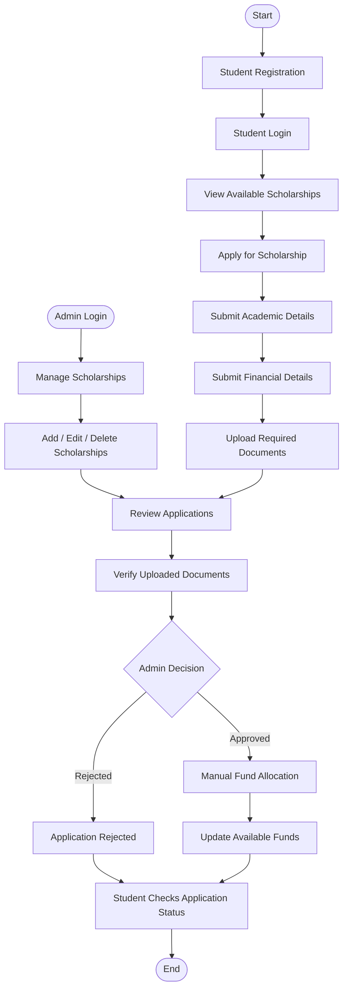

# Scholarship Eligibility and Fund Allocation Platform

## 1. Project Overview

The **Scholarship Eligibility and Fund Allocation Platform** is a web-based application developed to simplify and manage the scholarship application and fund allocation process.

The system provides a centralized platform where students can register, explore available scholarships, submit applications, enter academic and financial details, and upload required documents.

Administrators can manage scholarships, review student applications, verify submitted documents, approve or reject applications, and allocate scholarship funds manually.

The main objective is to improve transparency, reduce manual work, and make scholarship management more efficient.


## 2. Features

The Scholarship Eligibility and Fund Allocation Platform provides separate functionalities for students and administrators to simplify scholarship applications and fund management.

### 2.1 Student Module

- **Student Registration and Login:** Students can create accounts and securely log in.
- **View Scholarships:** Browse available scholarships and their details.
- **Check Eligibility:** View scholarship requirements such as academic percentage, family income, and category.
- **Apply for Scholarships:** Submit scholarship applications through the platform.
- **Academic and Financial Details:** Provide required academic and family income information.
- **Document Upload:** Upload supporting documents required for scholarship applications.
- **Track Application Status:** Check whether applications are pending, approved, rejected, or allocated.
- **View Fund Allocation:** View approved scholarship details and allocated amounts.
- **Password Reset:** Reset forgotten passwords through email-based OTP verification.

### 2.2 Admin Module

- **Admin Login:** Secure access to the administration dashboard.
- **Dashboard:** View statistics related to students, scholarships, applications, and allocated funds.
- **Scholarship Management:** Add, edit, and delete scholarship opportunities.
- **Student Management:** View registered student details.
- **Application Review:** Review submitted scholarship applications and student information.
- **Document Verification:** Verify uploaded supporting documents.
- **Application Decision:** Approve or reject scholarship applications.
- **Fund Allocation:** Manually allocate funds to approved applications.
- **Fund Tracking:** Monitor allocated funds and update available scholarship balances.

### 2.3 General Features

- Role-based access for students and administrators.
- MySQL database integration for data management.
- Secure password hashing using Werkzeug.
- Email-based OTP verification for password reset.
- Supporting document upload and management.
- Application status tracking.
- Scholarship fund management.

### Overall Outcome

The platform simplifies the scholarship application process for students and helps administrators manage scholarships, review applications, verify documents, and allocate funds efficiently.

## 3. Technology Stack

| Category | Technologies |
|---|---|
| Frontend | HTML, CSS, Bootstrap 5, JavaScript |
| Backend | Python, Flask |
| Database | MySQL |
| Database Connector | mysql-connector-python |
| Authentication | Flask Sessions, Werkzeug Password Hashing |
| Email Service | Python Email / SMTP |
| Development Tools | Visual Studio Code, Git, GitHub |


## 4. Project Workflow

The Scholarship Eligibility and Fund Allocation Platform follows two major workflows: Student Scholarship Application and Admin Scholarship Management.

### Workflow Diagram



### Workflow Description

**Student Workflow:**
1. Student registers and logs into the platform.
2. Views available scholarships and eligibility requirements.
3. Selects and applies for a suitable scholarship.
4. Submits academic and financial details.
5. Uploads the required supporting documents.

**Admin Workflow:**
1. Administrator logs into the admin panel.
2. Adds new scholarships, edits existing scholarship details, or deletes scholarships.
3. Reviews submitted student applications.
4. Verifies uploaded supporting documents.
5. Approves or rejects applications.
6. Manually allocates scholarship funds to approved applications.
7. Updates the available scholarship funds after successful allocation.

**Final Step:**

Students can log in to check their application status and view their allocated scholarship amount, if applicable.


## 5. Project Setup and Installation

### Prerequisites

- Python 3.10 or above
- MySQL Server
- Git
- Visual Studio Code (recommended)

### Step 1: Clone the Repository

```bash
git clone https://github.com/lalithya2910/scholarship-
```

### Step 2: Navigate to the Project Directory

```bash
cd scholarship-
```

### Step 3: Create a Virtual Environment

```bash
python -m venv venv
```

### Step 4: Activate the Virtual Environment

For Windows:

```bash
venv\Scripts\activate
```

### Step 5: Install Dependencies

```bash
pip install -r requirements.txt
```

### Step 6: Configure the Database

1. Start your MySQL Server.
2. Create a database named `scholarship`.
3. Import the provided SQL database file.
4. Configure the database connection details in the `.env` file.

### Step 7: Run the Application

```bash
python app.py
```

Open your browser and visit:

```text
http://127.0.0.1:5000/
```

## 6. Environment Variables

Create a `.env` file in the project root directory and configure the following variables:

```env
DB_HOST=localhost
DB_PORT=3306
DB_USER=root
DB_PASSWORD=your_mysql_password
DB_NAME=scholarship

SECRET_KEY=your_secret_key

MAIL_USERNAME=your_email@gmail.com
MAIL_PASSWORD=your_email_app_password
```

**Note:** Replace the example values with your actual configuration. Never upload your `.env` file or expose database credentials and email passwords on GitHub.

## 7. API and Database Notes

### Database

The application uses MySQL to store and manage student, scholarship, application, academic, financial, document, and fund allocation information.

Major database tables include:

- `students` – Stores student registration details.
- `admins` – Stores administrator login details.
- `scholarships` – Stores scholarship information and funding limits.
- `applications` – Stores student scholarship applications and their statuses.
- `academic_details` – Stores academic information.
- `financial_details` – Stores family income and financial information.
- `documents` – Stores uploaded document references and verification status.
- `scholarship_required_documents` – Stores required documents for scholarships.
- `fund_allocations` – Stores scholarship fund allocation records.
- `bank_details` – Stores student bank account-related information.

### Application Processing

- Flask routes handle student and admin requests.
- MySQL queries perform database operations.
- Student and scholarship information is stored in relational tables.
- Application status is updated based on administrator decisions.
- Fund allocation records are maintained in the database.
- Available scholarship funds are updated after successful allocation.

The application primarily uses Flask server-side routes and does not depend on a separate REST API service.


## 8. Team Member Contributions

### Individual Project Development

**Team Member:** Lalithya Vanacharla  
**Role:** Full Stack Developer

This project was independently developed by Lalithya Vanacharla, who handled the complete development process, from requirement analysis to implementation and testing.

### Key Responsibilities

- **Requirement Analysis:** Identified project requirements and planned the student and admin workflows.
- **Frontend Development:** Designed responsive user interfaces using HTML, CSS, Bootstrap 5, and JavaScript.
- **Backend Development:** Implemented application functionality using Python and Flask, including authentication, scholarship applications, and application management.
- **Database Integration:** Designed and managed the MySQL database and integrated it with Flask using `mysql-connector-python`.
- **Scholarship Management:** Developed features to add, edit, and delete scholarships, review applications, and verify documents.
- **Fund Allocation:** Implemented manual scholarship fund allocation and available balance updates.
- **Security:** Implemented password hashing, role-based access, session management, and email-based OTP verification.
- **Testing and Documentation:** Tested application workflows, fixed errors, maintained the GitHub repository, and prepared project documentation.

### Development Outcome

Successfully developed a web-based platform that simplifies scholarship applications, student document verification, application review, and scholarship fund allocation.

## 9. Future Scope

- Automated scholarship eligibility verification.
- Applicant priority scoring and ranking.
- Online scholarship payment integration.
- Advanced analytics and report generation.
- SMS notifications for application updates.
- Mobile application support.

## 10. Conclusion

The Scholarship Eligibility and Fund Allocation Platform provides an organized and transparent approach to managing scholarship applications. It reduces administrative workload, simplifies document verification, and helps administrators manage scholarship approvals and fund allocation efficiently.

## 11. Repository

GitHub: [Scholarship Eligibility and Fund Allocation Platform](https://github.com/lalithya2910/scholarship-)
